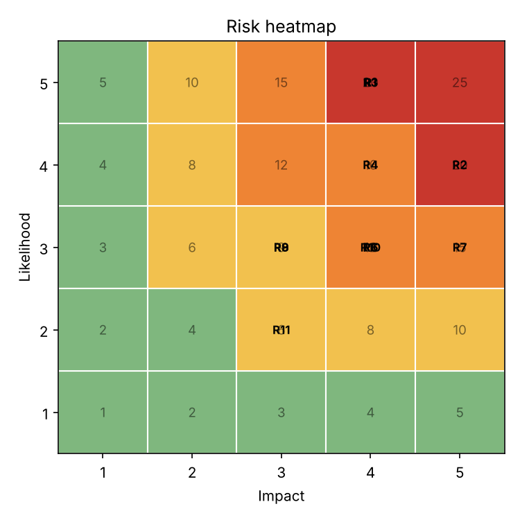
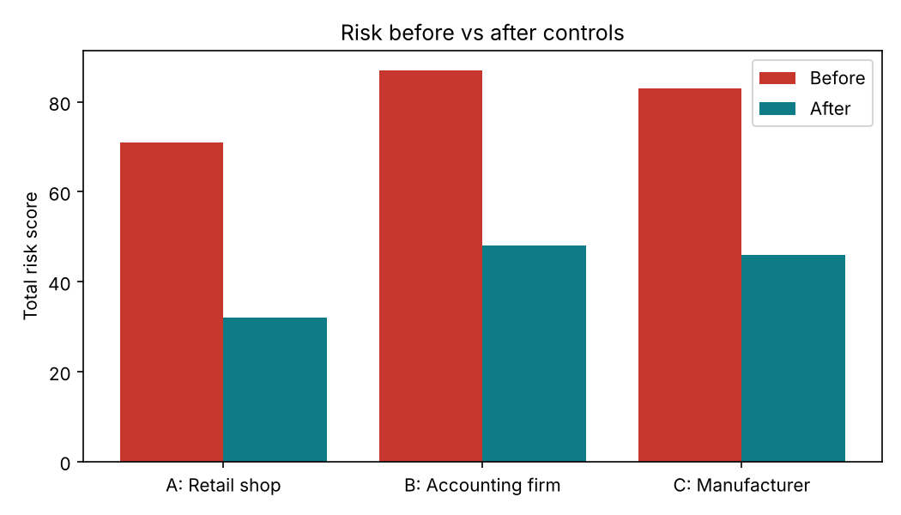

# Cybersecurity Risk Assessment Framework for Small Businesses

Minor Project 1 | Naviotech Solution Pvt Ltd internship | November 2026
Author: Devesh soni , Group-G, LIET College,Alwar

A lightweight, NIST CSF 2.0 aligned framework that helps small and medium enterprises (SMEs) identify, score and prioritise cybersecurity risks, plus a small Python tool that automates the scoring.

## What this project does

1. Researches common SME threats (phishing, ransomware, weak authentication, unpatched software, insider and third-party risk).
2. Builds a risk assessment model around the six NIST CSF 2.0 functions: Govern, Identify, Protect, Detect, Respond, Recover.
3. Defines a risk metric: **Risk Score = Likelihood (1-5) x Impact (1-5)**.
4. Proposes low-cost mitigation strategies (technical, people, process).
5. Validates the model with three illustrative case studies.
6. Documents findings and best practices.

## Risk bands

| Score | Band | Action |
|---|---|---|
| 20-25 | Critical | Fix immediately |
| 12-19 | High | Fix within 30 days |
| 6-11 | Medium | Plan within the quarter |
| 1-5 | Low | Accept and monitor |

## Results

| Case | Total risk before | After controls | Reduction |
|---|---|---|---|
| A: Retail shop (12 staff) | 71 | 32 | 55% |
| B: Accounting firm (40 staff) | 87 | 48 | 45% |
| C: Manufacturer (25 staff) | 83 | 46 | 45% |

Totals are the sum of Likelihood x Impact for the five highest risks in each case. The case studies are illustrative profiles created to demonstrate the model.




## Repository structure

```
.
├── README.md
├── risk_assessment.py          # scoring / ranking CLI
├── requirements.txt            # matplotlib (optional, for charts)
├── data/
│   ├── risk_register.csv       # baseline SME risk register
│   └── case_studies.csv        # before/after scores for 3 cases
├── docs/
│   ├── SME_Cyber_Risk_Assessment_Presentation.pptx
│   ├── ranked_register.csv
│   └── images/
├── tests/test_risk_assessment.py
└── LICENSE
```

Add the full project report (Word/PDF) to `docs/` before submitting.

## Usage

Requires Python 3.8+. No dependencies except optional `matplotlib` for charts.

```bash
# Rank the baseline risk register (optionally save CSV and heatmap)
python risk_assessment.py rank data/risk_register.csv --out ranked.csv --heatmap heatmap.png

# Compare before/after risk for the case studies
python risk_assessment.py cases data/case_studies.csv --chart case_results.png

# Interactive 10-question self-assessment for an SME
python risk_assessment.py checklist

# Run tests
python -m unittest discover -s tests
```

To assess your own business, copy `data/risk_register.csv`, edit the threats and the `likelihood` and `impact` columns (1-5), and run the `rank` command.

## Priority order for limited budgets

1. Enable MFA on email, banking and admin accounts
2. Set up offsite backups and test a restore
3. Turn on automatic updates; replace unsupported systems
4. Run basic phishing awareness training
5. Deploy endpoint protection and a firewall; separate guest Wi-Fi
6. Write a one-page incident response plan

## Limitations and future work

- Scores are subjective estimates; averaging several reviewers improves reliability.
- Case studies are illustrative; field validation with real organisations would strengthen results.
- Future work: web/spreadsheet front end, industry-specific weights, mapping to ISO 27001 and India's DPDP Act.

## References

- NIST, The NIST Cybersecurity Framework (CSF) 2.0, 2024
- NIST SP 800-30 Rev. 1, Guide for Conducting Risk Assessments
- CISA, Cybersecurity Resources for Small Businesses
- ENISA, Cybersecurity Guide for SMEs
- CERT-In, Guidelines on Cyber Security Best Practices

## License

MIT, see [LICENSE](LICENSE).
